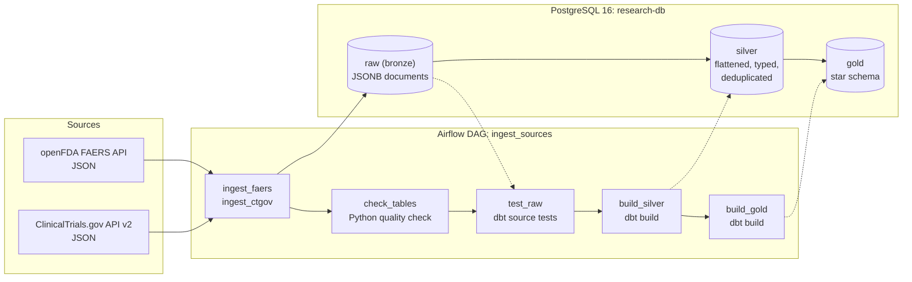
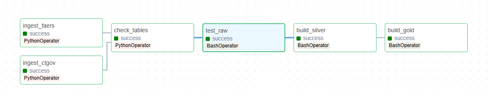
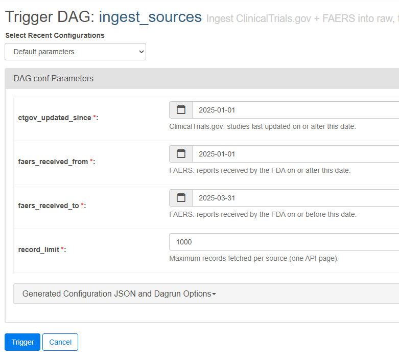
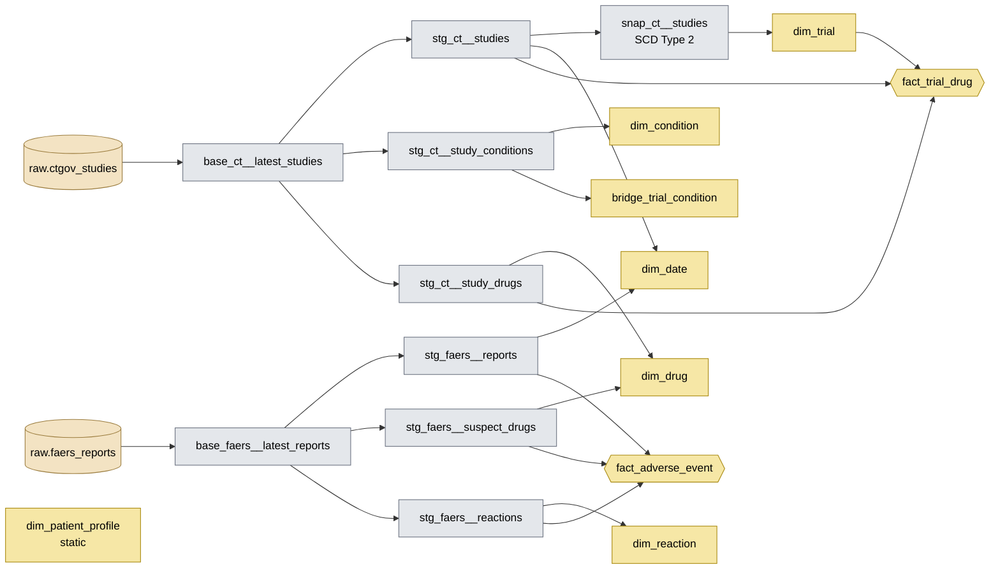
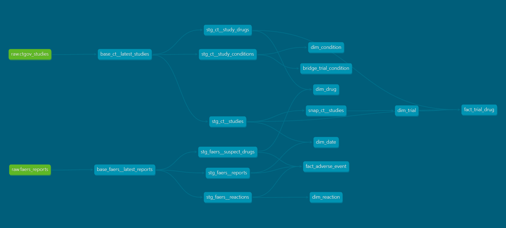
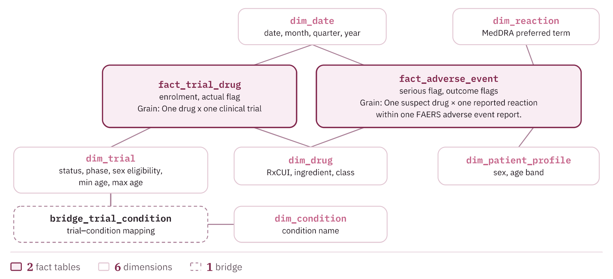

# Women in Drug Research and Safety

Data Engineering (University of Tartu, fall 2026), **Project 2: data warehouse implementation
and ETL pipelines**.

**Team:** Anett Sitsi, Ann Marleen Varul, Anne-Mai Melles, Beatrice Hellrand, Oskar Telgmaa

## Goal

Compare how women are represented in clinical research with how they appear in post-market drug
safety reports, to flag drugs and conditions where the two diverge.

| KPI | Business questions |
|---|---|
| 1. Share of trials open to women (women-only, men-only, all sexes) | Q1: share of trials open to women by start year and phase. Q2: conditions with the lowest share of trials open to women |
| 2. Female share of adverse event reports per drug | Q3: drugs with the highest female share of reports. Q4: reactions reported more often by women than men |
| 3. Serious-outcome rate by sex | Q5: do women report serious outcomes more often than men, by age group? |

## Data sources

| Source | Content | Access |
|---|---|---|
| [openFDA drug adverse events (FAERS)](https://open.fda.gov/apis/drug/event/) | Individual adverse event reports: suspect drugs, MedDRA reactions, patient sex and age, seriousness | REST API, JSON, free API key |
| [ClinicalTrials.gov API v2](https://clinicaltrials.gov/data-api/api) | Interventional drug/biological trials: status, phase, eligible sex and ages, conditions, interventions, enrollment | REST API, JSON, no key |

Both are record-level, nested JSON. They are stored unchanged and flattened in dbt (see
[extra credit B](#extra-credit-b-semi-structured-data)).

## Changes since Project 1

| Area | Project 1 design | Project 2 implementation | Why |
|---|---|---|---|
| Drug matching | Link FAERS and trials through RxNorm ingredient codes (RxCUI) | Match on a normalised ingredient name ([`normalize_drug_name`](dbt/macros/normalize_drug_name.sql)); RxCUI is kept as an attribute in `dim_drug` | ClinicalTrials.gov has no RxCUIs, only free-text intervention names |
| Bronze layer | `raw` schema in PostgreSQL | Same, named `raw`; it is the **bronze** layer of the medallion architecture | |
| Silver layer | "Staging (dbt)" | `silver` schema: 6 staging tables + the `snap_ct__studies` snapshot (SCD Type 2 for `dim_trial`) | |
| Quality gate | dbt tests must pass before the warehouse is updated | Implemented as Airflow task order: `check_tables` -> `test_raw` -> `build_silver` -> `build_gold`; any failure stops the DAG | |
| Reporting | Superset / Streamlit | Not implemented; results are produced by dbt analyses ([`docs/results/queries.md`](docs/results/queries.md)) | Out of scope for Project 2 |
| `dim_date` | Static calendar | Generated spine, 2000-2035, widened automatically to cover the data (some trials start in 1991) | |

## Architecture



| Layer | Schema | Built by | Contents |
|---|---|---|---|
| Bronze | `raw` | Airflow (Python) | `faers_reports`, `ctgov_studies`: one row per document version, the whole API record as `JSONB`, keyed by ID + version, with `batch_id` and `loaded_at` |
| Silver | `silver` | dbt | `stg_faers__reports`, `stg_faers__suspect_drugs`, `stg_faers__reactions`, `stg_ct__studies`, `stg_ct__study_conditions`, `stg_ct__study_drugs`, snapshot `snap_ct__studies` |
| Gold | `gold` | dbt | 2 facts, 6 dimensions, 1 bridge (see [star schema](#star-schema)) |

Everything runs in Docker Compose ([`compose.yml`](compose.yml)): `research-db` (the
warehouse), `airflow-db` (Airflow metadata), `airflow-webserver`, `airflow-scheduler`,
`airflow-init` and `pgadmin`. dbt is installed in its own virtual environment inside the Airflow
image ([`Dockerfile.airflow`](Dockerfile.airflow)) so its dependencies do not clash with Airflow's.

**Database engine: PostgreSQL 16.** The sources are nested JSON (native `JSONB`), loads are
row-level and transactional (idempotent inserts, SCD Type 2 snapshot), the volume is small
(about 60 MB after two runs) and several containers share one server. A columnar engine
(DuckDB/ClickHouse) would scan faster at much larger volumes, but its costs (single writer or
asynchronous updates, a second service) fall on exactly the operations this pipeline performs.
Full reasoning: [`docs/database_engine_choice.md`](docs/database_engine_choice.md).

## Repository contents

```text
compose.yml, Dockerfile.airflow, .env.example   Docker setup and configuration template
sql/create_raw_tables.sql                       DDL for the raw (bronze) tables, run on first start
dags/ingest_sources.py                          the Airflow DAG: ingestion, quality checks, dbt
dbt/
  models/silver/                                staging models, sources (_sources.yml) and docs (_silver.yml)
  models/gold/                                  star schema and docs/tests (_gold.yml)
  snapshots/                                    SCD Type 2 snapshot of trials
  macros/                                       drug-name normalisation, age/date decoding, keys, JSON paths
  tests/                                        singular data tests (+ generic unique_combination)
  analyses/                                     Q1-Q5 business queries; semi_structured/ = extra credit B
docs/
  database_engine_choice.md                     engine justification
  semi_structured_integration.md                extra credit B write-up
  results/                                      generated query results (queries.md, semi_structured.md)
scripts/
  run_analyses.py                               runs compiled dbt analyses -> Markdown tables
  download_*.py, load_*.py                      standalone helpers from early development (not used by the DAG)
images/                                         screenshots and diagrams
```

## Setup and run

**Prerequisites:** Docker Desktop (Compose v2), an
[openFDA API key](https://open.fda.gov/apis/authentication/) (free). About 2 GB of disk for images.

### 1. Configure

```bash
cp .env.example .env        # PowerShell: Copy-Item .env.example .env
```

Edit `.env` and set at least `OPENFDA_API_KEY`; change the example passwords if you like.

| Variable | Used by | Default |
|---|---|---|
| `RESEARCH_DB_USER`, `RESEARCH_DB_PASSWORD`, `RESEARCH_DB_NAME` | warehouse database, Airflow connection `women_db`, dbt profile | `research_user` / `local_research_pass` / `women_research` |
| `RESEARCH_DB_PORT` | warehouse port on the host (for local SQL clients) | `55432` |
| `AIRFLOW_DB_USER`, `AIRFLOW_DB_PASSWORD`, `AIRFLOW_DB_NAME` | Airflow metadata database | `airflow` / `local_airflow_pass` / `airflow` |
| `AIRFLOW_ADMIN_USER`, `AIRFLOW_ADMIN_PASSWORD` | Airflow web login | `airflow` / `local_airflow_admin` |
| `AIRFLOW_WEB_PORT` | Airflow UI | `8085` |
| `PGADMIN_EMAIL`, `PGADMIN_PASSWORD`, `PGADMIN_PORT` | pgAdmin UI | `admin@example.com` / `local_admin_pass` / `5055` |
| `OPENFDA_API_KEY` | `ingest_faers` task | (required, empty in the template) |

Credentials are never hard-coded: Compose passes them to the containers, the DAG reads the
Airflow connection `AIRFLOW_CONN_WOMEN_DB`, and [`dbt/profiles.yml`](dbt/profiles.yml) uses
`env_var()`.

### 2. Build and start

```bash
docker compose build
docker compose up -d
docker compose ps -a        # research-db/airflow-db healthy, airflow-init "Exited (0)", others Up
docker compose exec airflow-scheduler airflow dags list-import-errors   # expect none
```

### 3. Run the pipeline

Open the Airflow UI at http://localhost:8085, log in with `AIRFLOW_ADMIN_USER` /
`AIRFLOW_ADMIN_PASSWORD`, unpause `ingest_sources` and choose **Trigger DAG**. Or, from the CLI:

```bash
docker compose exec airflow-scheduler airflow dags unpause ingest_sources
docker compose exec airflow-scheduler airflow dags trigger ingest_sources \
  --conf '{"ctgov_updated_since": "2025-01-01", "faers_received_from": "2025-01-01", "faers_received_to": "2025-03-31", "record_limit": 1000}'
```

A run takes 1-3 minutes. All six tasks should succeed.

### 4. Check the result

```bash
docker compose exec research-db sh -c 'psql -U "$POSTGRES_USER" -d "$POSTGRES_DB"'
```

```sql
SELECT table_schema, count(*) FROM information_schema.tables
WHERE table_schema IN ('raw', 'silver', 'gold') GROUP BY 1;   -- raw 2, silver 7, gold 9
SELECT count(*) FROM gold.fact_adverse_event;
SELECT count(*) FROM gold.dim_patient_profile;                -- always 15
```

Triggering again with the same parameters is a no-op: the ingest logs show `Inserted: 0`,
`Skipped (already loaded): 1000`, and all counts stay the same.

### 5. Reproduce the query results

```bash
docker compose exec airflow-scheduler /opt/dbt/bin/dbt compile --select path:analyses --project-dir /opt/airflow/dbt --profiles-dir /opt/airflow/dbt --target-path /opt/airflow/dbt-target --log-path /opt/airflow/dbt-logs
docker compose exec -T airflow-scheduler python - . < scripts/run_analyses.py               # Q1-Q5
docker compose exec -T airflow-scheduler python - semi_structured < scripts/run_analyses.py # extra credit B
docker compose cp airflow-scheduler:/opt/airflow/dbt-target/results/. docs/results/
```

In Windows PowerShell 5.1, replace `... < scripts/run_analyses.py` with
`Get-Content scripts/run_analyses.py -Raw | docker compose exec -T airflow-scheduler python - .`

## Airflow DAG

[`dags/ingest_sources.py`](dags/ingest_sources.py), DAG `ingest_sources` (manual schedule, one
run at a time, 2 retries per task).



| Task | What it does |
|---|---|
| `ingest_ctgov` | Calls ClinicalTrials.gov for interventional drug/biological studies updated since `ctgov_updated_since`, sorted by update date; stores each study in `raw.ctgov_studies` |
| `ingest_faers` | Calls openFDA for reports received between `faers_received_from` and `faers_received_to`, sorted by date; stores each report in `raw.faers_reports` |
| `check_tables` | **Data-quality check**: every record fetched in this run is present in raw (keys passed via XCom), and no raw row has a null key or an empty payload |
| `test_raw` | `dbt test --select source:raw`: key uniqueness and not-null, consistency between key columns and JSON, schema-drift warning |
| `build_silver` | `dbt build` of the silver models and their tests |
| `build_gold` | `dbt build` of the snapshot and the gold star schema, with their tests |

**Parameters** (trigger form):



| Parameter | Default | Meaning |
|---|---|---|
| `ctgov_updated_since` | `2025-01-01` | ClinicalTrials.gov studies last updated on or after this date |
| `faers_received_from` / `faers_received_to` | `2025-01-01` / `2025-03-31` | FAERS reports received in this window (the run fails if from > to) |
| `record_limit` | `1000` | Maximum records per source (1-1000, one API page) |

**Idempotency.** Raw tables have the primary keys (`nct_id`, `source_updated_date`) and
(`report_id`, `report_version`), and inserts use `ON CONFLICT DO NOTHING`. Both API queries are
date-sorted, so the same parameters fetch the same records and a rerun inserts nothing. A new
version of a document is a new raw row; silver keeps the latest version, and the snapshot records
trial changes. Silver and gold are rebuilt from raw on every run, so they cannot accumulate
duplicates. Verified: a second run with identical parameters gave identical row counts in all
layers, and a run with `faers_received_from` > `faers_received_to` failed at `ingest_faers`
without touching gold.

## dbt project

[`dbt/`](dbt/) (dbt-core 1.10, dbt-postgres 1.9). Details: [`dbt/README.md`](dbt/README.md).



The `base_*` models are ephemeral (inlined): they pick the latest version of each document. The
same graph generated by `dbt docs generate` (tests and analyses hidden):



**Tests.** Generic tests (`unique`, `not_null`, `relationships`, `accepted_values`, and a custom
[`unique_combination`](dbt/tests/generic/unique_combination.sql)) are declared in
[`_sources.yml`](dbt/models/silver/_sources.yml), [`_silver.yml`](dbt/models/silver/_silver.yml)
and [`_gold.yml`](dbt/models/gold/_gold.yml). Every fact foreign key has a `relationships` test.
Singular tests in [`dbt/tests/`](dbt/tests/):

| Test | Checks |
|---|---|
| `assert_raw_faers_payload`, `assert_raw_ctgov_payload` | Key columns match the IDs inside the JSON; payload is an object |
| `warn_raw_payload_schema_drift` | (warn) every JSON path the models depend on still occurs in the data |
| `assert_trial_age_range_valid` | Minimum eligible age is not above the maximum |
| `assert_one_current_version_per_trial`, `assert_trial_versions_do_not_overlap` | SCD Type 2 history in `dim_trial` is consistent |

**Documentation.** Every silver and gold model and column is described in the YAML files above;
`dbt docs generate` turns them into the browsable docs site.

## Star schema

2 fact tables, 6 dimensions and 1 bridge table.



| Table | Grain | SCD type |
|---|---|---|
| `fact_adverse_event` | One suspect drug x one reaction within one FAERS report (latest version) | n/a |
| `fact_trial_drug` | One drug x one clinical trial | n/a |
| `dim_trial` | One row per version of a trial | Type 2 (via snapshot) |
| `dim_drug` | One row per normalised ingredient name, with flags for appearing in FAERS and in trials | Type 1 |
| `dim_condition` | One row per condition (case variants merged) | Type 1 |
| `dim_reaction` | One row per MedDRA preferred term | Static |
| `dim_patient_profile` | One row per sex x age band (15 rows) | Static |
| `dim_date` | One row per day | Static |
| `bridge_trial_condition` | One row per trial x condition | n/a |

`bridge_trial_condition.nct_id` is not a formal foreign key: `dim_trial` keeps several rows per
trial (one per version), so queries join it to the current row (`is_current`).

Physical design: all tables are in the `gold` schema with B-tree indexes on surrogate keys, fact
foreign keys and the columns the queries group by (configured in
[`dbt_project.yml`](dbt/dbt_project.yml)). Surrogate keys are deterministic hashes of the natural
keys, so a rebuild produces the same keys.

## Analytical query results

SQL: [`dbt/analyses/`](dbt/analyses/). Full results: [`docs/results/queries.md`](docs/results/queries.md).
Data: two pipeline runs (default parameters plus one earlier unparameterised run), 1,997 trials
and 2,000 FAERS reports, run on 2026-11-23.

### Q1: share of trials open to women, by phase and start period

| Grouped by | Group | Trials | % open to women | % women only | % men only | % all sexes |
|---|---|---|---|---|---|---|
| Phase | Early phase 1 | 70 | 97.1 | 5.7 | 2.9 | 91.4 |
| Phase | Phase 1 | 395 | 92.2 | 3.8 | 7.8 | 88.4 |
| Phase | Phase 1/2 | 164 | 96.3 | 4.3 | 3.7 | 92.1 |
| Phase | Phase 2 | 565 | 96.8 | 7.8 | 3.2 | 89.0 |
| Phase | Phase 2/3 | 55 | 100.0 | 12.7 | 0.0 | 87.3 |
| Phase | Phase 3 | 257 | 95.3 | 5.4 | 4.7 | 89.9 |
| Phase | Phase 4 | 251 | 97.6 | 7.2 | 2.4 | 90.4 |
| Phase | Not applicable | 230 | 96.1 | 12.6 | 3.9 | 83.5 |
| Start period | Before 2010 | 257 | 93.4 | 10.1 | 6.6 | 83.3 |
| Start period | 2010-2019 | 590 | 95.9 | 7.8 | 4.1 | 88.1 |
| Start period | 2020 or later | 1,131 | 96.2 | 5.8 | 3.8 | 90.4 |
| Start period | Unknown | 9 | 100.0 | 0.0 | 0.0 | 100.0 |

Almost all trials (1,987 with a drug intervention) are open to women. The exception is phase 1,
where men-only trials are most common (7.8 %, against 0-4.7 % in later phases). That is the stage
where a drug's safety and dosing are first established. The share of men-only trials has fallen
from 6.6 % before 2010 to 3.8 % since 2020.

The year x phase breakdown (214 rows) is in [`docs/results/queries.md`](docs/results/queries.md).

### Q2: conditions with the lowest share of trials open to women (at least 5 trials)

| Condition | Trials | % open to women |
|---|---|---|
| Prostate Cancer | 18 | 11.1 |
| Healthy | 44 | 77.3 |
| Vitamin D Deficiency | 5 | 80.0 |
| Healthy Volunteer | 5 | 80.0 |
| Type 2 Diabetes | 11 | 81.8 |
| Pharmacokinetics | 7 | 85.7 |
| Healthy Participants | 9 | 88.9 |
| Healthy Volunteers | 30 | 90.0 |
| COVID-19 | 15 | 93.3 |
| HIV Infections | 17 | 94.1 |

Prostate cancer is expected. More notable is that trials in healthy volunteers (typically
early-phase studies of safety and dosing) are less often open to women than trials of most
diseases.

### Q3: drugs with the highest female share of adverse event reports (at least 20 reports)

| Ingredient | Drug class | In trials | Female reports | Male reports | % female |
|---|---|---|---|---|---|
| levonorgestrel | Progestin | no | 23 | 0 | 100.0 |
| ambrisentan | Endothelin receptor antagonist | no | 173 | 61 | 73.9 |
| dupilumab | IL-4 receptor alpha antagonist | yes | 77 | 30 | 72.0 |
| insulin glargine | Insulin analog | yes | 16 | 8 | 66.7 |
| prednisone | Corticosteroid | yes | 12 | 8 | 60.0 |
| divalproex | | no | 54 | 40 | 57.4 |
| ruxolitinib | Kinase inhibitor | yes | 60 | 45 | 57.1 |
| adalimumab | TNF blocker | yes | 17 | 13 | 56.7 |
| lenalidomide | Thalidomide analog | yes | 17 | 14 | 54.8 |
| pimavanserin | | yes | 23 | 28 | 45.1 |

### Q4: reactions reported more often by women than by men (share of each sex's reports)

| Reaction (MedDRA PT) | Female reports | Male reports | % of female reports | % of male reports | Difference (pp) |
|---|---|---|---|---|---|
| Pain | 47 | 9 | 4.38 | 1.40 | 2.97 |
| Headache | 47 | 11 | 4.38 | 1.72 | 2.66 |
| Product dose omission issue | 33 | 10 | 3.07 | 1.56 | 1.51 |
| Dizziness | 38 | 13 | 3.54 | 2.03 | 1.51 |
| Drug hypersensitivity | 16 | 0 | 1.49 | 0.00 | 1.49 |
| Injury | 17 | 1 | 1.58 | 0.16 | 1.43 |
| Pruritus | 27 | 7 | 2.51 | 1.09 | 1.42 |
| Accidental exposure to product | 19 | 3 | 1.77 | 0.47 | 1.30 |
| Diarrhoea | 47 | 20 | 4.38 | 3.12 | 1.26 |
| Insomnia | 23 | 6 | 2.14 | 0.94 | 1.21 |

### Q5: serious outcomes by sex and age band (reports with known sex)

| Age band | Sex | Reports | % serious | % death | % hospitalisation |
|---|---|---|---|---|---|
| 0-17 | Female | 46 | 23.9 | 2.2 | 15.2 |
| 0-17 | Male | 57 | 24.6 | 3.5 | 15.8 |
| 18-44 | Female | 169 | 51.5 | 2.4 | 24.3 |
| 18-44 | Male | 76 | 69.7 | 11.8 | 28.9 |
| 45-64 | Female | 244 | 44.7 | 5.7 | 17.6 |
| 45-64 | Male | 133 | 58.6 | 7.5 | 24.8 |
| 65+ | Female | 306 | 44.8 | 7.2 | 21.6 |
| 65+ | Male | 211 | 64.0 | 17.5 | 28.0 |
| Unknown | Female | 309 | 40.8 | 7.4 | 12.6 |
| Unknown | Male | 164 | 50.0 | 15.9 | 14.0 |

In this sample, women file more reports than men in every adult age band, but a smaller share of
their reports are serious. That is consistent with women reporting more non-serious reactions
(Q4: pain, headache, dizziness), not with women having fewer serious events.

## Extra credit B: semi-structured data

Both sources are nested JSON APIs. The DAG stores each record unchanged as a PostgreSQL `JSONB`
document (only ID and version are extracted, for the primary key), and dbt handles the structure:
nested objects via JSON path operators, arrays exploded with `jsonb_array_elements`, optional
fields, three alternative fields for a drug's name, string-encoded codes and partial dates,
document versions, and a schema-drift test.

- Write-up and comparison with conventional PostgreSQL tables:
  [`docs/semi_structured_integration.md`](docs/semi_structured_integration.md)
- Profiling queries: [`dbt/analyses/semi_structured/`](dbt/analyses/semi_structured/);
  results: [`docs/results/semi_structured.md`](docs/results/semi_structured.md)
- Drift test: [`dbt/tests/warn_raw_payload_schema_drift.sql`](dbt/tests/warn_raw_payload_schema_drift.sql),
  path list: [`dbt/macros/semi_structured_paths.sql`](dbt/macros/semi_structured_paths.sql)

## Limitations

- FAERS is spontaneous reporting with no denominator: it shows reporting patterns, not how often
  reactions occur. Counts here come from 2,000 reports and are illustrative, not representative.
- ClinicalTrials.gov eligibility shows who *could* enrol, not how many women actually took part.
- Drugs are matched across sources by normalised name, so brand names or misspellings in free
  text can create separate `dim_drug` rows (2,951 drugs from 2,000 reports and 1,997 trials).
- Each run fetches one API page (up to 1,000 records) per source; a full historical load would
  need pagination or the openFDA bulk files.
