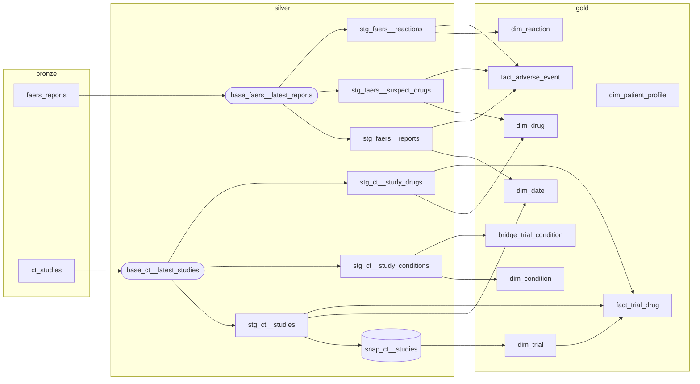

# dbt project: bronze → silver → gold

Transforms raw openFDA FAERS and ClinicalTrials.gov JSON (bronze, loaded by Airflow) into the
Project 1 star schema (gold) in PostgreSQL.

## Run

```bash
pip install -r requirements.txt
export WAREHOUSE_HOST=localhost WAREHOUSE_PORT=5432 WAREHOUSE_DB=warehouse \
       WAREHOUSE_USER=... WAREHOUSE_PASSWORD=...
export DBT_PROFILES_DIR=.          # profiles.yml in this folder reads the env vars above

dbt build                          # models + snapshot + all tests, in dependency order
dbt docs generate && dbt docs serve  # documentation site + lineage graph (screenshot for README)
```

No ingestion yet? Load sample data first: `psql -d warehouse -f scripts/sample_bronze.sql`.
`scripts/sample_bronze_update.sql` simulates the next load (a trial status change and a corrected
FAERS report version) to demonstrate SCD Type 2 and the incremental fact; run `dbt build` again after it.

**From Airflow:** `dbt build --select silver` then `dbt build --select gold+ snap_ct__studies`
as two tasks, or a single `dbt build`. A failing test skips everything downstream of it, so the
previous gold tables stay live (the Project 1 quality gate).

## Layers

| Layer | Schema | Built by | Contents |
|---|---|---|---|
| Bronze | `bronze` | Airflow | `faers_reports`, `ct_studies`: one JSONB payload per record, as received |
| Silver | `silver` | dbt | Deduplicated, flattened, decoded tables (`stg_*`) + trial history snapshot |
| Gold | `gold` | dbt | Star schema: 2 facts, 6 dimensions, 1 bridge |

### Bronze contract (for the ingestion DAGs)

```sql
bronze.faers_reports (safetyreportid text, payload jsonb, load_date date, ingested_at timestamptz)
bronze.ct_studies    (nct_id text,         payload jsonb, load_date date, ingested_at timestamptz)
```
`payload` = one element of the API's `results` (FAERS) or `studies` (ClinicalTrials.gov) array.
For idempotency, the DAG deletes rows for its `load_date` before inserting.

## Lineage


Rounded nodes are ephemeral (not stored); the cylinder is the SCD Type 2 snapshot.

## Gold model

| Table | Grain / rows | SCD | Notes |
|---|---|---|---|
| `fact_adverse_event` | one suspect drug × one reaction × one FAERS report | – | **Incremental**, delete+insert by `report_id` |
| `fact_trial_drug` | one drug × one trial | – | `trial_key` = trial version current at load time |
| `dim_trial` | one row per trial version | Type 2 | From dbt snapshot (timestamp strategy on last update date) |
| `dim_drug` | one row per normalised ingredient | Type 1 | Flags `appears_in_faers`, `appears_in_trials` |
| `dim_condition` | one row per condition | Type 1 | Case variants merged |
| `dim_reaction` | one row per MedDRA preferred term | Static | |
| `dim_patient_profile` | sex × age band (15 rows) | Static | Generated, not data-derived |
| `dim_date` | one row per day | Static | Range widened automatically to cover the data |
| `bridge_trial_condition` | one trial × one condition | – | Join on `nct_id` to current `dim_trial` row |

Full column descriptions: `models/silver/_silver.yml`, `models/gold/_gold.yml`, or `dbt docs serve`.

## Tests (84 configured data tests, confirmed by `dbt parse`)

- **Generic:** `unique`, `not_null`, `accepted_values` (sex, age band, eligible sex),
  `relationships` (every fact foreign key → its dimension).
- **Custom generic:** `tests/generic/unique_combination.sql` (composite keys, e.g. bridge PK).
- **Singular:** one current version per trial; no overlapping trial versions;
  min age ≤ max age (severity `warn`, so it reports without stopping the pipeline).

## Analyses (business questions Q1–Q5)

`analyses/q1…q5_*.sql`. Compile with `dbt compile --select "analyses/*"` and run the SQL from
`target/compiled/women_drug_safety/analyses/`. Minimum group sizes are vars in `dbt_project.yml`.

## Design decisions and changes from Project 1

1. **Hash surrogate keys instead of SERIAL.** `md5` of the natural key (macro `surrogate_key`).
   Dimensions are rebuilt every run; hash keys stay identical, so the incremental fact table never
   points to a stale key. Keys are computed in the fact directly, and integrity is enforced by
   `relationships` tests.
2. **`dim_drug` natural key is the normalised ingredient name, not RxCUI.** ClinicalTrials.gov has no
   RxCUI, so the name is the only attribute both sources share. Macro `normalize_drug_name` strips
   doses, parentheses, salts and dosage forms (`Metformin 500 mg tablets` and `METFORMIN
   HYDROCHLORIDE` → `metformin`). RxCUI is kept as an attribute from openFDA, where it is a
   product-level code.
3. **Incremental fact with delete+insert on `report_id`.** A corrected FAERS report replaces all rows
   of the old version, so dropped drugs or reactions do not linger. Re-running is idempotent.
4. **SCD Type 2 via dbt snapshot**, using ClinicalTrials.gov's last-update date, so `valid_from`
   is the date the registry changed, not the date we happened to load it.
5. **Seriousness is report-level.** Analyses count `DISTINCT report_id`, because the fact grain repeats
   report attributes for each drug × reaction combination.

## Known limitations

- Name matching misses combination products written differently (`sitagliptin and metformin` vs
  `sitagliptin/metformin`) and brand names in trials. `dim_drug.appears_in_*` shows the match rate.
- Q1 counts only trials testing a drug or biological, because it is built on `fact_trial_drug`.
- FAERS reports are voluntary; shares describe reporting patterns, not incidence.
